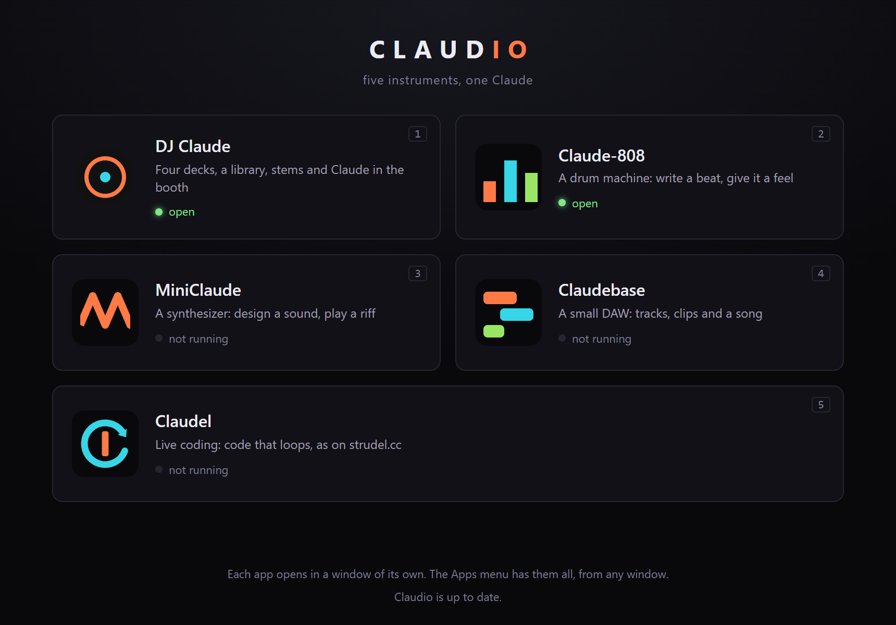
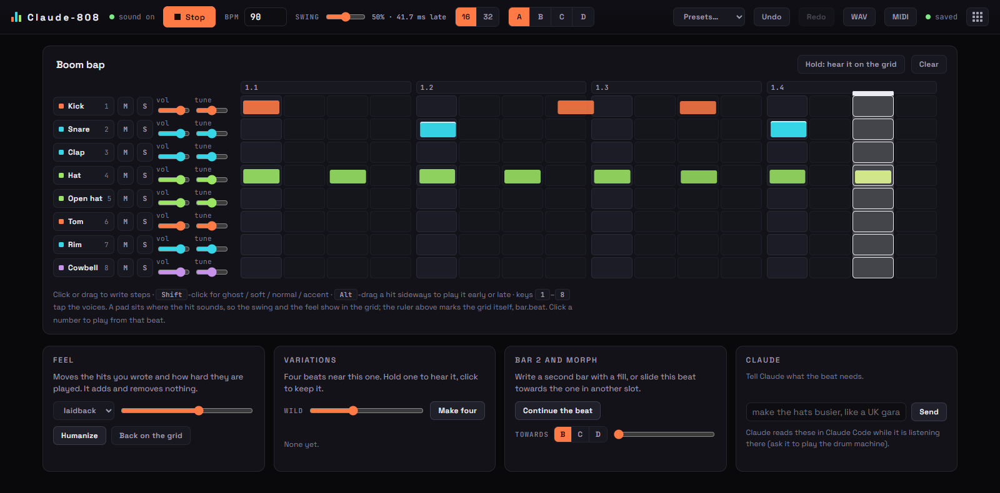
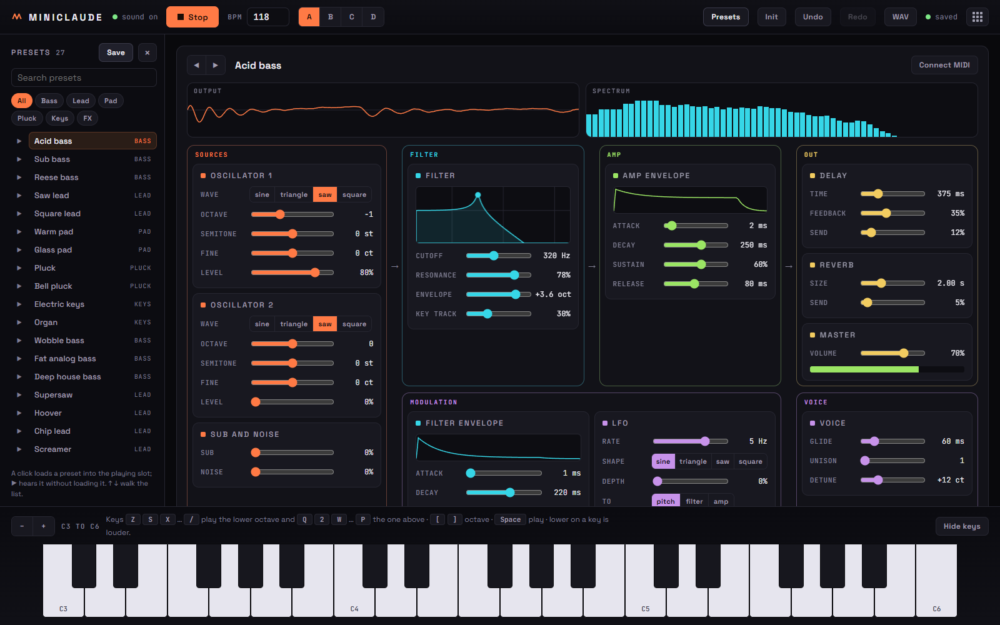
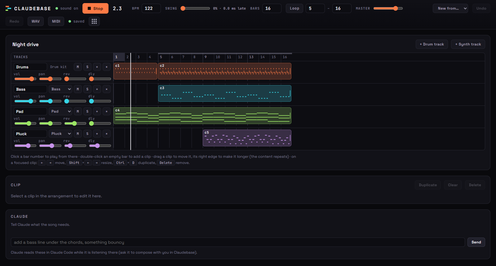
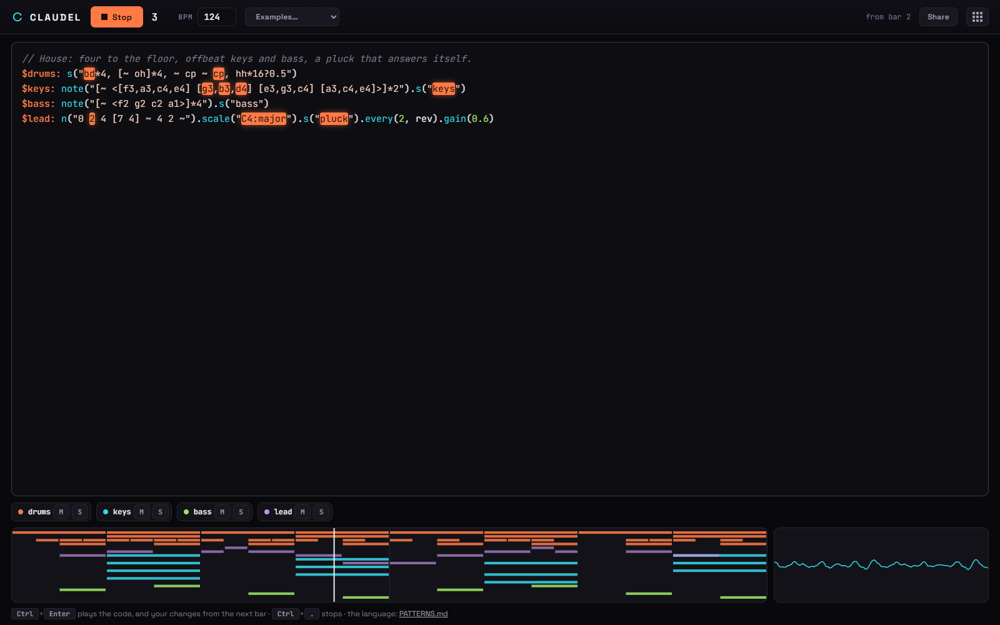

<h1 align="center"></h1>

**Claudio** is a suite of five music apps that **Claude Code plays**: a DJ rig, a drum machine, a synthesizer, a small
DAW and a live-coding loop. You say what you want in plain text ("play Sandstorm next", "a boom bap beat", "a fat
detuned bass", "a house track"); Claude drives the app through its CLI and you hear it in the app's page. Each app
can be played by hand too.

<p align="center"></p>

| | What it is |
|---|---|
| **DJ Claude** | Four decks, a mixer, a library and the booth. Claude picks the tracks, times the mixes on the beat and takes requests. |
| **Claude-808** | A drum machine where every hit also has an offset in milliseconds, so a beat keeps its groove. |
| **MiniClaude** | A polyphonic synthesizer with four patch slots and a sixteen-step sequencer. |
| **Claudebase** | A small DAW: drum and synth tracks, clips on a bar timeline, MIDI export. |
| **Claudel** | Live coding: code that loops, as on strudel.cc, in Strudel's mini-notation; change it while it plays. |

Everything runs locally: a small Node server per app and Web Audio in the page (ffmpeg for the DJ's analysis, yt-dlp
for its crate). No npm dependencies outside the desktop app.

## Install
**The desktop app (Windows).** Download `Claudio-Setup-<version>.exe` from the latest
[release](https://github.com/tomek-i/claudio/releases/latest) and run it (it is not code-signed, so Windows asks
first). On its first start it makes a project folder, **Documents/Claudio**, with the CLIs and Claude's skills in it.
Open [Claude Code](https://claude.com/claude-code) in that folder and start talking. It updates itself from the
releases. More in [The desktop app](docs/desktop-app.md).

**From source (any platform).** Requirements: **Node 20+**, **ffmpeg + ffprobe** on PATH, a Chromium-based browser,
and [Claude Code](https://claude.com/claude-code).
```bash
git clone https://github.com/tomek-i/claudio.git && cd claudio
node dj.mjs doctor --fix     # checks the server, engine and library, downloads yt-dlp into bin/
node dj.mjs demo             # optional: 12 Creative Commons tracks (hip-hop, house, techno, drum & bass)
node dj.mjs start            # starts DJ Claude and opens http://localhost:4747
pnpm all                     # or: all five servers in one terminal
```
For the desktop app from source: `pnpm install` once (Electron), then `pnpm desktop`.

## DJ Claude
You direct the set in plain text ("play Sandstorm next", "kill the bass", "harder", "mix into something darker");
Claude reads the crate, picks tracks, times the mixes on the beat and talks to the booth. The browser tab is the sound
system and the visuals.


```
you (typing in Claude Code) ──► Claude + DJ skills ──► node dj.mjs … ──► server ──► browser audio engine ──► speakers
                                                                 ▲                         │
                                                crowd requests from the booth ◄────────────┘
```

Click **Start engine** in the tab once (browsers need one click before they may play audio; the desktop app needs
none). Drop some music into `data/dj/library/` or let Claude download it. An empty crate shows a **Download demo
tracks** button that fetches the same starter crate as `dj demo` (tracks and licences in
[apps/server/demo-tracks/README.md](apps/server/demo-tracks/README.md)). Then open Claude Code in this folder and talk
to it:

- `play a 30 minute house set that builds to a peak`
- `get me Darude - Sandstorm and Headhunterz - Dragonborn`
- `mix into Sandstorm on the next phrase` · `kill the bass… bring it back on the drop`
- `harder` · `chill it out` · `loop this` · `wrap it up in 10 minutes`
- `record this and make me a video of the set`

People in the room can type requests into the **booth** box in the browser; Claude sees them as crowd requests.

The page can be played by hand too: drag a track from the crate onto a deck (or drop audio files from your computer on
one to import and load them), drag the big waveform to scratch, hold Alt to move the playhead silently, and use the
mouse wheel on it to zoom. A playing deck is locked against waveform drags unless you hold Shift or open the lock.

## The other four
Each has its own server and page and shares no code with the DJ rig or with the others. Ask Claude for "a boom bap
beat", "a fat detuned bass" or "a house track" and it uses the right one.

<table>
<tr>
<td width="50%"><a href="apps/drums/README.md"></a><br><b>Claude-808</b> · <code>pnpm drums</code> → http://localhost:4748</td>
<td width="50%"><a href="apps/synth/README.md"></a><br><b>MiniClaude</b> · <code>pnpm synth</code> → http://localhost:4749</td>
</tr>
<tr>
<td width="50%"><a href="apps/daw/README.md"></a><br><b>Claudebase</b> · <code>pnpm daw</code> → http://localhost:4750</td>
<td width="50%"><a href="apps/live/README.md"></a><br><b>Claudel</b> · <code>pnpm live</code> → http://localhost:4751</td>
</tr>
</table>

`pnpm all` starts all five servers in one terminal, each line marked with its app; one Ctrl+C stops them. Every page
has an **Apps** menu in its header with the five, a dot for each one running: a click opens one in a new tab, and one
that is not running shows the command that starts it. In the desktop app the menu opens the app's window and starts it.

## Documentation
| | |
|---|---|
| [The desktop app](docs/desktop-app.md) | Claudio's home window, what it adds over browser tabs, the installer, updates, and the project folder the installed app makes. |
| [How it works](docs/how-it-works.md) | The pieces, the skills that make Claude a DJ, the one sound system, transitions and timing. |
| [Stems](docs/stems.md) | Splitting tracks into vocals, drums, bass and other: `node dj.mjs stems setup`, GPU or CPU. |
| [Visuals](docs/visuals.md) | The full-screen visualiser at `/visuals` for a second screen or a projector. |
| [Videos, speech clips and albums](docs/production.md) | Recording a set and rendering a video; talk clips as vocals; a produced album. |
| [Configuration and data](docs/configuration.md) | `config.json` and the settings page, key bindings, what is kept in `data/`. |
| [Development](docs/development.md) | Tests, benchmarks, CI, releases, building the installer. |

`node dj.mjs help` lists every DJ command; each of the other apps' CLIs has its own `help`. `CLAUDE.md` is the map of
the code, written for Claude.

## Notes
- Built for personal use with music you have the rights to play. Downloads are your responsibility.
- Windows is the primary platform (PowerShell/Git Bash), and the installer is Windows only. The servers and pages are
  plain Node + browser and run elsewhere, but paths such as fonts in `tools/produce/viz.mjs` default to Windows and may
  need `VIZ_FONT_BOLD`.
