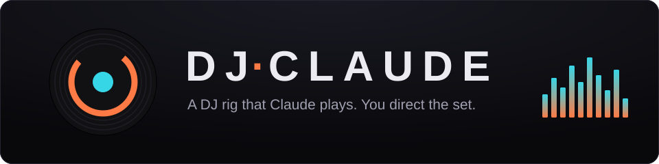
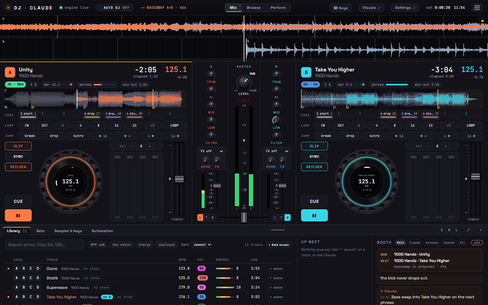

<h1 align="center"></h1>

A DJ rig that **Claude Code plays**. You direct the set in plain text ("play Sandstorm next", "kill the bass", "harder",
"mix into something darker"); Claude reads the crate, picks tracks, times the mixes on the beat and talks to the booth.
The browser tab is the sound system and the visuals.



```
you (typing in Claude Code) ──► Claude + DJ skills ──► node dj.mjs … ──► server ──► browser audio engine ──► speakers
                                                                 ▲                         │
                                                crowd requests from the booth ◄────────────┘
```

Everything runs locally: a Node server, a Web Audio engine in your browser, ffmpeg for analysis, yt-dlp for the crate.
No npm dependencies.

## Quick start
Requirements: **Node 20+**, **ffmpeg + ffprobe** on PATH, a Chromium-based browser, and [Claude Code](https://claude.com/claude-code).

```bash
git clone <this repo> dj-claude && cd dj-claude
node dj.mjs doctor --fix     # checks the server, engine and library, downloads yt-dlp into bin/
node dj.mjs demo          # optional: 12 Creative Commons tracks (hip-hop, house, techno, drum & bass) into data/dj/library/demo/
node dj.mjs start            # starts the server and opens http://localhost:4747
```
Click **Start engine** in the tab once (browsers need one click before they may play audio). Drop some music into
`data/dj/library/` or let Claude download it. An empty crate shows a **Download demo tracks** button that fetches the same
starter crate as `dj demo` (tracks and licences in [apps/server/demo-tracks/README.md](apps/server/demo-tracks/README.md)). Then open Claude Code in
this folder and talk to it:

- `play a 30 minute house set that builds to a peak`
- `get me Darude - Sandstorm and Headhunterz - Dragonborn`
- `mix into Sandstorm on the next phrase` · `kill the bass… bring it back on the drop`
- `harder` · `chill it out` · `loop this` · `wrap it up in 10 minutes`
- `record this and make me a video of the set`

People in the room can type requests into the **booth** box in the browser; Claude sees them as crowd requests.

The page can be played by hand too: drag a track from the crate onto a deck (or drop audio files from your computer on
one to import and load them), drag the big waveform to scratch, hold Alt to move the playhead silently, and use the
mouse wheel on it to zoom. A playing deck is locked against waveform drags unless you hold Shift or open the lock.

### As a desktop app
**Claudio**, the desktop suite: DJ Claude and the drum machine, synth and DAW, each in a window of its own, opened from
one home window, with no **Start engine** click:
```bash
pnpm install     # once: Electron, for the desktop app only
pnpm desktop
```
Or install it: each [release](https://github.com/tomek-i/dj-claude/releases) has a Windows installer. The installed
app makes its own project folder (Documents/Claudio) with the CLIs and the skills in it; open Claude Code there.
More in [The desktop app](docs/desktop-app.md).

## Documentation
| | |
|---|---|
| [The desktop app](docs/desktop-app.md) | Claudio, the suite: the home window, what it adds over browser tabs, the installer, and the project folder the installed app makes. |
| [How it works](docs/how-it-works.md) | The pieces, the skills that make Claude a DJ, the one sound system, transitions and timing. |
| [Stems](docs/stems.md) | Splitting tracks into vocals, drums, bass and other: `node dj.mjs stems setup`, GPU or CPU. |
| [Visuals](docs/visuals.md) | The full-screen visualiser at `/visuals` for a second screen or a projector. |
| [Videos, speech clips and albums](docs/production.md) | Recording a set and rendering a video; talk clips as vocals; a produced album. |
| [Configuration and data](docs/configuration.md) | `config.json` and the settings page, key bindings, what is kept in `data/dj/`. |
| [Development](docs/development.md) | Tests, benchmarks, CI, releases, building the installer. |

`node dj.mjs help` lists every command. `CLAUDE.md` is the map of the code, written for Claude.

## Also in this repository
Four small instruments, each with its own server and page (three of them with a CLI and a skill that Claude plays
them with), sharing no code with the DJ rig or with each other. They live here for now.

| | Start it | What it is |
|---|---|---|
| **Claude-808** | `pnpm drums` → http://localhost:4748 | A drum machine where every hit also has an offset in milliseconds, so a beat keeps its groove. [apps/drums](apps/drums/README.md) |
| **MiniClaude** | `pnpm synth` → http://localhost:4749 | A polyphonic synthesizer with four patch slots and a sixteen-step sequencer. [apps/synth](apps/synth/README.md) |
| **Claudebase** | `pnpm daw` → http://localhost:4750 | A small DAW: drum and synth tracks, clips on a bar timeline, MIDI export. [apps/daw](apps/daw/README.md) |
| **Claudel** | `pnpm live` → http://localhost:4751 | Live coding: code that loops, as on strudel.cc, in Strudel's mini-notation; change it while it plays. [apps/live](apps/live/README.md) |

Ask Claude for "a boom bap beat", "a fat detuned bass" or "a house track" and it uses the right one.

`pnpm all` starts all five servers (the DJ rig too) in one terminal, each line marked with its app; one Ctrl+C stops
them. Every page has an **Apps** menu in its header with the five, a dot for each one running: a click opens one in a
new tab, and one that is not running shows the command that starts it. In the desktop app, Claudio, the menu opens the
app's window and starts it.

## Notes
- Built for personal use with music you have the rights to play. Downloads are your responsibility.
- Windows is the primary platform (PowerShell/Git Bash); the engine and server are plain Node + browser and run elsewhere, but
  paths such as fonts in `tools/produce/viz.mjs` default to Windows and may need `VIZ_FONT_BOLD`.
